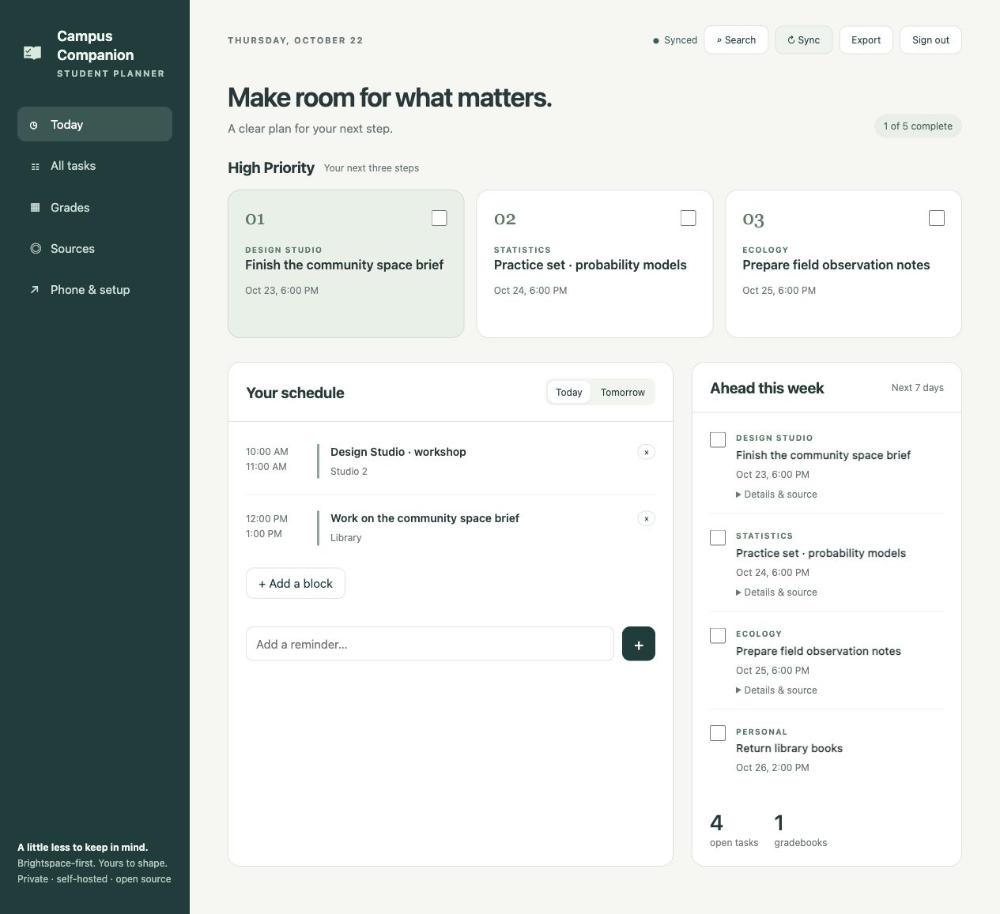
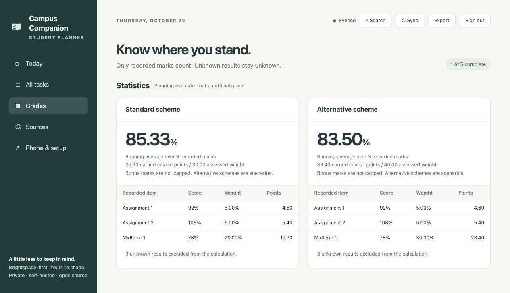
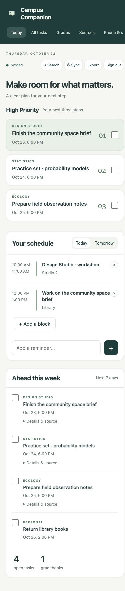
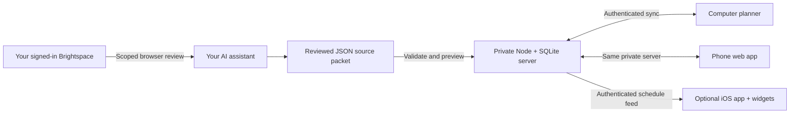

<div align="center">
  
  <h1>Campus Companion</h1>
  <p><strong>A Brightspace-first student planner for your computer and phone.</strong></p>
  <p>Courses, priorities, plans and grades — with less to keep in your head.</p>
  <p>
    <a href="https://github.com/owenmcfarlane/campus-companion/actions/workflows/check.yml"></a>
    
    <a href="LICENSE"></a>
    
  </p>
  <p><a href="START-HERE.md">Set it up with your AI assistant</a> · <a href="docs/PHONE.md">Connect your phone</a> · <a href="docs/TROUBLESHOOTING.md">Get help</a></p>
</div>



## What it is

Campus Companion is a small, self-hosted planner for one student. It is the generalized, independently deployable edition of Student Sticky. It keeps the useful everyday features and removes personal course rules, private records and dependencies on the original hosted account. It works across programs: assignments, essays, labs, projects, placements and personal reminders all use the same task model.

An AI assistant can read your authorized, signed-in course pages and prepare a structured update. Local code validates and imports that update. The app then handles display, search, grade calculations and device synchronization **without calling an AI model**.

**Brightspace is the primary workflow.** Other learning systems can supply the same import format, but need their own verified source mapping and browser workflow. A similar-looking LMS is not automatically supported. This is an independent project, not an official D2L or university integration. There is no bundled credential scraper, hidden LMS API, or automatic assessment-taking.

## What you get

| Feature | Included behavior |
|---|---|
| High Priority | Three open, available tasks ranked by deadline, with inline completion |
| Today & Tomorrow | Saved study/class blocks, manual additions and removals, reminders |
| Task search | Local title/course matching, plus `today`, `tomorrow` and `overdue` |
| Grades | Known marks only, confirmed zeros, uncapped bonus scores, alternative scheme scenarios and visible calculation rows |
| Device sync | A durable local queue, atomic SQLite writes, idempotent requests, explicit conflict review |
| Phone web app | Responsive interface and installable Home Screen app; saved offline state |
| iPhone companion | SwiftUI source, schedule bridge, Home/Lock Screen widgets and optional silent local reminders |
| Source freshness | Explicit verified/partial/blocked receipts, separate from sync status |
| Portable data | JSON export, previewed source imports and local revision history |
| AI handoff | Two small skills, an ordered setup runbook and a token-conscious maintenance workflow |

This basic edition uses manual schedule blocks. Adaptive rhythm learning, automatic calendar packing, email ingestion, WHOOP, a native Mac sticky window and server-driven web push are **not included**. The browser notification button sends an on-demand priority digest; scheduled phone reminders use the optional iOS app. These boundaries keep the public version understandable and inexpensive to maintain.

## Quick start

You need **Node.js 24 or newer** and Git. There are no npm packages to install and no frontend build step.

```bash
git clone https://github.com/owenmcfarlane/campus-companion.git
cd campus-companion
npm run setup -- --demo
npm start
```

Open **http://localhost:4173**. Open `.local/login-key.txt` locally and use that key to sign in. Do not commit it or paste it into a public chat. The sample courses and marks are fictional. Setup refuses to replace existing data.

For a real, empty planner, use `npm run setup` without `--demo` in a fresh checkout. If you want to explore the demo separately, set `CAMPUS_DATA_DIR` to a different private directory for **both** setup and start. See [setup](docs/SETUP.md).

### Let your AI assistant do the setup

Open this repository in Codex or another capable coding assistant and paste:

> Read START-HERE.md and follow its numbered setup checklist. Start with the local planner, ask only for missing configuration, and preserve existing data. Verify my own Brightspace account before importing facts. Use the compact-context and token framework for recurring maintenance. Do not deploy publicly, schedule recurring work, or access optional services until I request them. Keep a private setup-state.local.md with completed checks and concrete blockers so you can answer my setup questions later.

**Expect initial setup to use a substantial amount of tokens — much more than routine maintenance.** Your assistant must discover courses, understand grading schemes, configure access and verify everything the first time. Later runs should use far fewer tokens by checking changes, retaining source receipts and doing arithmetic and synchronization in code. Actual usage varies by course count, source layout, model and required repairs; this project does not promise a fixed saving or minimum. [How the token framework works →](docs/TOKEN-FRAMEWORK.md)

## What it looks like

All images below are actual captures of this repository’s app using fictional demo data.

| Recorded grades, with transparent weights | Responsive phone layout |
|---|---|
|  |  |

The phone image is a browser viewport test, not proof of installation on a physical phone.

## How it works



Your university password remains with your normal login flow. The planner uses a separate generated login key and an HttpOnly session cookie. Each installation serves **one student**. Use separate deployments for different people; this is not a multi-tenant university service.

The database is stored under `.local/`, which Git ignores. The service worker caches only app assets, never course APIs. Your last loaded data and pending edits are stored locally on each signed-in device for offline use. Sign out clears that browser’s saved planner after pending changes have synced. Device access and OS disk protection still matter.

A checked course page, a saved planner change and a successful phone sync are three different results. The UI and review workflow keep them separate. Completion checkmarks belong to the student; an import does not mark something done because its deadline passed or an LMS says it was viewed.

## Grades that respect missing information

A running grade is:

**100 × earned weighted course points ÷ weight represented by recorded marks.**

If eight equally weighted assignments make up 25% of a course, each is worth 25/8 course percentage points. Two recorded 100% assignments produce a 100% assignment average; the other six are unknown, not zeros. A confirmed zero does count. A 108% score stays 108% in this planning model.

Alternative grading schemes appear separately. The app does not decide that a student qualifies for a replacement scheme, or represent the estimate as the university’s official grade. Confirm syllabus rules first. Supported components are single assessments, confirmed equal-weight groups and best-of groups; more complex rules need an explicit implementation and tests.

## Phone connection and hosting

The easiest phone setup is the web app: host the server behind **HTTPS**, open the same address on your phone, sign in, and add it to your Home Screen. Both devices then use the same SQLite-backed planner. The server must be running for live sync; offline edits wait safely.

For widgets and silent local reminders, configure and build the included iOS companion in Xcode. Its bridge accepts only your configured HTTPS origin. It refreshes saved schedules while open; it does not inspect Brightspace in the background. Phone reminders can use the last imported schedule while the laptop is closed, but they may become stale after remote edits until the companion refreshes.

See [PHONE.md](docs/PHONE.md) for both paths, [DEPLOYMENT.md](docs/DEPLOYMENT.md) for hosting, and [SECURITY.md](SECURITY.md) before putting personal data on a server.

## Documentation map

| File | Read it when… |
|---|---|
| [START-HERE.md](START-HERE.md) | An AI assistant is setting up a new student |
| [Setup](docs/SETUP.md) | Configuring accounts, permissions and the first verified import |
| [Brightspace workflow](docs/BRIGHTSPACE.md) | Reviewing source pages or adapting a different LMS |
| [Data & API](docs/DATA.md) | Preparing imports, grade schemes or a connector |
| [Phone](docs/PHONE.md) | Installing the web app or native companion |
| [Deployment](docs/DEPLOYMENT.md) | Running a private HTTPS server with durable storage |
| [Token framework](docs/TOKEN-FRAMEWORK.md) | Keeping recurring work small and accurate |
| [Troubleshooting](docs/TROUBLESHOOTING.md) | Fixing setup, sync, authentication or missing-source issues |
| [Architecture](docs/ARCHITECTURE.md) | Understanding code ownership and extension points |
| [Validation](docs/VALIDATION.md) | Seeing what was actually checked and what still needs device testing |

## Development and future updates

```bash
npm test             # arithmetic, preservation, conflict, auth and phone-feed tests
npm run check        # syntax, documentation links and private-data publication guards
npm run context      # compact private task/source summary for your assistant
```

The public repo is the shared baseline. Reusable fixes to grade math, sync, mobile behavior, accessibility and setup should be ported here with focused tests and a changelog entry. Personal timetables, grades, course documents, credentials and one-off exceptions stay private. [CONTRIBUTING.md](CONTRIBUTING.md) and [AGENTS.md](AGENTS.md) describe the workflow. This is an instruction for future authorized work, not a background updater.

MIT licensed. See [LICENSE](LICENSE). The repository contains original/generalized planner code and the companion source; third-party AI plugins and commercial services are not redistributed.
